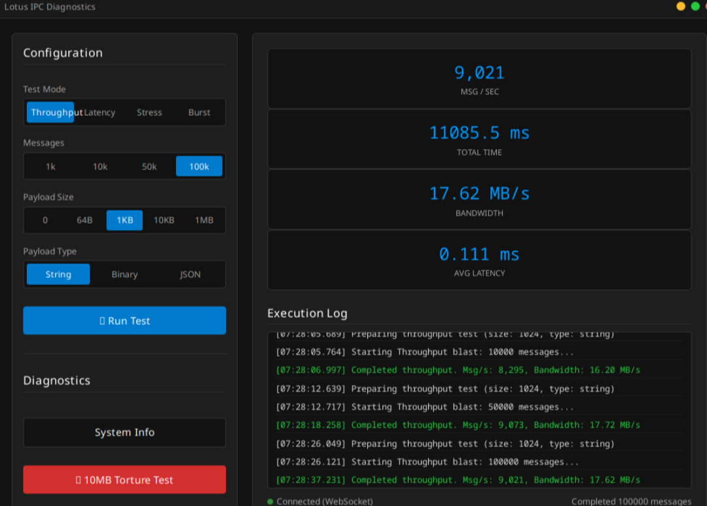

# Lotus (`lotus-gui`)

Lotus is a lightweight desktop GUI framework that pairs Node.js with the Servo rendering engine.

It is built for developers who want to write cross-platform desktop applications in HTML, CSS, and JavaScript without bundling an entire Chromium instance just to draw a window. Servo renders the pixels onto a hardware-accelerated OpenGL/ANGLE surface while Node.js runs your application logic and OS integration directly in the main process.

> **New here?** Read the [**Step-by-Step Tutorial (Building Your First Lotus App)**](./TUTORIAL.md) to build a frameless desktop monitor from scratch, or jump to the [Quick Start](#quick-start) below.

---

## Philosophy: Built Like a Lotus Elise

> *"If a part doesn't make it start faster, use less memory, or render pixels, it's gone. No extra suspension. No spare tires. No browser pretending to be an operating system."*

* **Architecture:**
  Node.js owns the OS. Servo paints the pixels. There are no artificial sandboxes between your Node.js process and the host machine, and no background telemetry. Lotus provides a native hardware-accelerated window and a binary-packed IPC bridge between your Node script and the DOM.
* **The Analogy:**
  * **Node.js** is the track.
  * **Servo** is the car.
  * **IPC** is the steering wheel.
  * *"On a track, you don't worry about potholes. You worry about lap times."*
* **The Point:**
  *"Node.js already does OS integration. We just needed a renderer. That's it. That's the whole project."*

---

## Quick Start

Pre-built native binaries for **Linux (`x86_64`)** and **Windows (`x64`)** are published on npm. You do not need Rust or a local Servo checkout to build apps with Lotus.

### Option 1: Scaffold with the CLI (Recommended)

```bash
npx @lotus-gui/dev init my-app
cd my-app
npm install
npx lotus dev main.js
```

### Option 2: Manual Setup

```bash
mkdir my-lotus-app && cd my-lotus-app
npm init -y
npm install @lotus-gui/core
npm install --save-dev @lotus-gui/dev
```

For a full walkthrough, follow [**TUTORIAL.md: Building Your First Lotus App**](./TUTORIAL.md).

---

## What's New in v0.4.0

* **Process-Isolated Sandboxed Panes (`sandbox: true`):** Run untrusted or third-party web content in an OS-level, multi-process sandbox (`PID_secure_engine`) managed by `lotus-supervisor`. Hardened with Landlock FS jailing, Seccomp Stage B BPF filters (`SECCOMP_FILTER_FLAG_TSYNC` on all 77 Servo threads), network namespaces (`CLONE_NEWNET`), anti-SSRF DNS-pinned proxy routing, zero-copy sealed shared memory (`memfd`), and capability-based Track 2 IPC.
* **Multi-Pane OpenGL Compositor:** Split a single window into multiple docked or floating web views (`Pane`s) on one shared OpenGL surface using `LayoutBuilder` (`Left`, `Right`, `Top`, `Bottom`, `Fill`, `Absolute`). Hiding or showing a docked pane automatically reflows the rest of the layout in Rust on the next frame.
* **Servo v0.7.0 Submodule:** Tracks upstream Servo v0.7.0 in-tree with a minimal 5-changed-line diff (33-line patch file: [`servo-compositor.patch`](./packages/lotus-core/servo-compositor.patch)) that passes a `target_fbo` parameter to `OffscreenRenderingContext` so multiple panes can blit into a single window's framebuffer.
* **Native `<select>` Overlays:** HTML `<select>` dropdowns render in a pre-warmed, high-z-index overlay pane above split panes so they never clip. Supports single-select, multi-select, `<optgroup>`, and runtime theming (`'auto'`, `'dark'`, `'light'`, or custom CSS/tokens).
* **Injected Overlay Scrollbars:** Auto-fading, GPU-positioned (`translate3d`) overlay scrollbars that expand on hover while staying decoupled from frameless window resize borders.
* **Encrypted VFS (`--encrypt`):** Package your `ui/` directory into an AEAD-encrypted (AES-256-GCM) virtual file system with native key sharding across ELF/PE binary sections and a 128MB byte-limited LRU cache.

### Upgrading from v0.3.x to v0.4.0

* **Single-window apps work without changes:** A standard `new ServoWindow({ root, index })` automatically creates a single `'main'` pane anchored to `Anchor.Fill` (`autoResizeMain: true` by default).
* **Multi-pane layouts require `autoResizeMain: false`:** When passing custom `panes` (or `...layout.config()`), set `autoResizeMain: false` on `ServoWindow` so the Rust compositor calculates docked pane boundaries rather than forcing a single `'main'` pane to fill the window.
* **New `Pane` and `<select>` APIs:** You can now manage split views dynamically via `win.createPane(id, opts)`, `win.getPane(id)`, `pane.toggleVisible()`, and `win.sendToPaneRenderer(paneId, ch, data)`, and customize dropdowns or scrollbars via `selectMenu` and `scrollbars` in `WindowOptions`.
* **Event & Option Aliases:** `ready-to-show` is the primary first-frame event (`frame-ready` remains supported as an alias), and `frameless: true` also accepts `frame: false` for Electron familiarity.

---

## Architecture & Performance

Cold start from process launch to `ready-to-show` (first painted frame) measures **~350 to 400ms on Linux** (release build, x86_64, timed with `--profile` from Node start to first frame callback). Windows is slower on first launch while compiling ANGLE shaders. Because all windows in a process share a single Servo constellation and rendering thread, opening an additional window adds **~80MB RSS** (measured via `/proc/<pid>/status` `VmRSS` delta when spawning a secondary `ServoWindow` in `test_app`).

In **Hybrid Mode (`lotus-resource://`)**, Lotus serves local `ui/` files directly from disk (or the in-memory Encrypted VFS) through a custom Rust protocol handler, avoiding a local HTTP file server or open static asset port. Directory jailing is enforced at the protocol layer so `../../` traversal outside your configured `root` directory is rejected.

For **IPC (`window.lotus` ↔ `ipcMain`)**, a local `tokio` + `axum` WebSocket bridge uses binary **MsgPack** (`msgpackr`) serialization, adaptive batching (up to 800 messages or 1MB per tick), and 128KB chunked streaming for multi-megabyte transfers. It supports both Promise-based request/reply (`await window.lotus.invoke()` ↔ `ipcMain.handle()`) and fire-and-forget messaging (`window.lotus.send()` ↔ `ipcMain.on()` / `win.sendToRenderer()`).


*Throughput benchmark in [`packages/lotus-core/ipc-benchmark`](./packages/lotus-core/ipc-benchmark) (`npm run benchmark`, release build on Linux x86_64): 100,000 pipelined 1KB string round-trips (~18,000 messages/sec total across both directions) completed in 11,085.5ms: **9,021 round-trips/s** (17.62 MiB/s) at **0.111ms** amortized pipelined time per round-trip. Note: this screenshot measures batched/pipelined throughput; single-in-flight sequential latency (accessible via the "Latency" tab in `npm run benchmark`) is higher as each hop waits for a full WebSocket + event-loop wakeup.*

Window rendering is built on `winit` 0.30 and `window-vibrancy` 0.5. By clearing the OpenGL surface to `0x00000000` and waiting for `ready-to-show` before calling `win.show()`, windows never flash a white rectangle during startup. Setting `frameless: true` removes OS chrome and attaches **DPI-scaled 6px resize borders** around the window perimeter in Rust with native directional resize cursors, while any HTML header marked with `-webkit-app-region: drag` (or `data-lotus-drag="true"`) lets the OS window manager handle dragging natively. Passing a static `id` to `new ServoWindow({ id: 'main' })` automatically saves and restores window coordinates, dimensions, and maximized state in `~/.config/<app-name>/window-state.json`.

---

## IPC Security Model & Process Isolation

Lotus distinguishes between trusted local application chrome and untrusted third-party content using two distinct execution tracks:

### Track 1: Trusted In-Process Windows & Panes
For trusted local UI (`lotus-resource://` and `localhost`), Node.js runs alongside Servo in the main process with high-speed direct IPC:
1. **Per-Session Ephemeral UUID Token:** On startup, Rust generates a random UUID v4 token. Any local process or WebSocket upgrade request on `127.0.0.1` without the exact token is rejected with `401 Unauthorized`.
2. **Origin-Scoped Token Injection:** The `UserScript` populating `window.lotus.token` only runs on `lotus-resource:` and `localhost`/`127.0.0.1`. Remote origins (such as `https://example.com`) never receive credentials.
3. **`Host` and `Origin` Header Validation:** The WebSocket upgrade handler validates that `Host` strictly targets `127.0.0.1` or `localhost` (preventing DNS rebinding).

### Track 2: Process-Isolated Sandboxed Panes (`sandbox: true`)
When embedding external websites, user-submitted HTML, or third-party web apps, set `sandbox: true` when creating the pane:
```javascript
const webPane = win.createPane('browser', {
    url: 'https://untrusted-site.org',
    sandbox: true,                       // Spawns in an unprivileged, sandboxed child engine
    allowedChannels: ['vault'],          // Strictly whitelist authorized capability channels
    trustedOrigins: ['https://untrusted-site.org']
});
```
* **OS-Level Hardened Sandbox:** Runs inside `CLONE_NEWUSER`, `CLONE_NEWNET`, and `CLONE_NEWPID` namespaces with zero capabilities, Landlock filesystem jailing (zero write access, dedicated `0o700` sandbox dir, no host `/tmp` access), and Stage B Seccomp BPF filters across all 77 Servo threads.
* **Double-Mapped Shared Memory (SHM):** Frame pixels stream to the OpenGL compositor through read-only sealed `memfd` buffers (`0o400` + `SYS_fchmod` lockout), providing tear-free 60+ FPS rendering without network hops.
* **Anti-SSRF NetworkBroker:** Network egress is proxy-routed through `NetworkBroker` on the host, enforcing DNS socket pinning, blocking loopback and private IP ranges (RFC 1918), and enforcing a 64 MiB payload cap.
* **Capability Gating & Single-Use Tickets:** Sandboxed pages authenticate via `/ipc/handshake` with a constant-time bootstrap secret, receiving a single-use 256-bit ticket to upgrade to `/ipc/secure-ws`. Calls are restricted strictly to declared `allowedChannels`, and the client-side bridge uses call-stack inspection (`verifyTopRealm`) to block same-origin or `about:srcdoc` `<iframe>` attacks.
* **Automatic Crash Recovery:** If the sandboxed engine crashes or panics, the host supervisor detects the fault, cleans up descriptors, and transparently recovers on the next navigation without crashing your application.

---

## Current Limitations & Pre-1.0 Status

Lotus is currently at **`v0.4.0` (pre-1.0)**. While the core architecture is stable and used to build real Linux and Windows packages, you should evaluate these trade-offs before choosing it over Electron or Tauri:

* **Pre-1.0 API:** Minor versions (`0.x`) may introduce breaking API adjustments as upstream Servo evolves.
* **Servo Web Platform Coverage:** Servo v0.7.0 has strong support for modern HTML5, CSS Flexbox, CSS Grid, Canvas/WebGL, and ES6+, and Lotus polyfills Servo's missing `<select>` menus and overlay scrollbars. However, Servo is not Chromium: niche browser APIs (such as WebRTC, DRM/Widevine media, complex SVG filters, or Chromium-specific CSS extensions) are either unimplemented or experimental upstream. Lotus works best when you control your own frontend UI rather than embedding arbitrary third-party web apps.
* **DevTools Story:** Unlike Chromium's built-in F12 inspector panel, Servo's inspector relies on the Firefox remote debugging protocol, which is not yet wired up to `lotus dev` out of the box. Currently, debugging relies on standard console logging, IPC diagnostics, and `--profile` timing output.
* **Platform Coverage:** Linux (`x86_64`) and Windows (`x64`) are supported with pre-built binaries and installer generation. macOS (`arm64`) and FreeBSD are not currently supported.

---

## Minimal App Example

### 1. `main.js` (Node.js Main Process)

```javascript
const { ServoWindow, ipcMain, app } = require('@lotus-gui/core');
const path = require('path');

app.initVfs(); // Unlocks Encrypted VFS if built with --encrypt (safe no-op otherwise)
app.warmup();  // Pre-warm the Servo engine

const win = new ServoWindow({
    id: 'main-window',                // Remembers window size & position automatically
    root: path.join(__dirname, 'ui'), // Serves files via lotus-resource://localhost/
    index: 'index.html',
    width: 1024,
    height: 768,
    title: 'My Lotus App',
    frameless: true,
    transparent: true,
    visible: false,
    selectMenu: { theme: 'dark' },    // Theme the high-z-index <select> overlay ('auto', 'dark', 'light', or token object)
    scrollbars: { theme: 'dark', autoHide: true, width: 8 } // Configure injected GPU overlay scrollbars
});

// Reveal the window only after the first frame is painted -- zero white flash
win.once('ready-to-show', () => win.show());

// Switch <select> dropdown theme dynamically at runtime
ipcMain.on('set-theme', (theme) => win.setSelectMenuTheme(theme));

// Fire-and-forget IPC
ipcMain.on('hello', (data) => {
    console.log('Renderer says:', data);
    win.sendToRenderer('reply', { message: 'Hello from Node.js!' });
});

// Promise-based request/reply IPC
ipcMain.handle('get-time', async () => {
    return { ts: Date.now() };
});
```

### 2. `ui/index.html` (Servo Webpage)

```html
<!DOCTYPE html>
<html>
<head><title>My App</title></head>
<body style="background: transparent; margin: 0; font-family: system-ui, sans-serif;">
    <div style="background: rgba(15, 23, 42, 0.92); color: white; padding: 2rem; border-radius: 12px; height: 100vh; box-sizing: border-box;">
        <div style="-webkit-app-region: drag; cursor: grab; padding-bottom: 1rem; opacity: 0.7;">
            Drag anywhere here to move the window
        </div>
        <h1>Hello from Lotus</h1>
        <button onclick="window.lotus.send('hello', { from: 'renderer' })">
            Send Event to Node.js
        </button>
        <button onclick="getTime()">
            Invoke get-time (Promise)
        </button>
        <!-- Native <select> renders in a dedicated overlay pane so it never clips across split panes -->
        <select onchange="window.lotus.send('set-theme', this.value)">
            <optgroup label="Dropdown Theme">
                <option value="dark">Dark Overlay</option>
                <option value="light">Light Overlay</option>
            </optgroup>
        </select>
        <p id="output"></p>
    </div>
    <script>
        window.lotus.on('reply', (data) => {
            document.getElementById('output').textContent = data.message;
        });

        async function getTime() {
            const { ts } = await window.lotus.invoke('get-time');
            document.getElementById('output').textContent = 'Node time: ' + new Date(ts).toISOString();
        }
    </script>
</body>
</html>
```

### 3. Run & Package

```bash
# Run with live hot-reloading
npx lotus dev main.js

# Package into a native installer (dist/installers/)
npx lotus build --target deb          # or: rpm, appimage, pacman, flatpak
npx lotus build --platform win32 --target msi  # or: exe

# Package as a closed-source encrypted binary
npx lotus build --target deb --encrypt
```

---

## Documentation & Monorepo Structure

Lotus is organized as an npm workspaces monorepo with two packages:

| Document / Package | npm Package | Contents |
|--------------------|-------------|----------|
| [**Step-by-Step Tutorial**](./TUTORIAL.md) | None | Walkthrough building a frameless, transparent desktop monitor with IPC, multi-pane layouts, and packaging. |
| [**`@lotus-gui/core` Docs**](./packages/lotus-core/README.md) | `@lotus-gui/core` | API reference for `ServoWindow`, `LayoutBuilder`, `Pane`, `ipcMain`, `app`, `<select>` theming, and overlay scrollbars. |
| [**`@lotus-gui/dev` Docs**](./packages/lotus-dev/README.md) | `@lotus-gui/dev` | Reference for `lotus init`, `lotus dev`, `lotus build`, `lotus.config.json`, SEA bundling, and `--encrypt`. |
| [**Contributor Guide**](./packages/lotus-core/CONTRIBUTING.md) | None | Instructions for building `@lotus-gui/core` locally, running showcase apps, and applying the Servo patch. |

```text
lotus/
├── TUTORIAL.md                         # Step-by-step beginner & intermediate tutorial
├── packages/
│   ├── lotus-core/                     # @lotus-gui/core -- Runtime engine (Servo + Node bindings)
│   │   ├── src/lib.rs                  # Rust N-API bindings, Winit loop, GL compositor, IPC
│   │   ├── src/window_state.rs         # Automatic window position/size persistence
│   │   ├── src/platform.rs             # OS theme detection & cursor integration
│   │   ├── lotus.js                    # High-level JS API (ServoWindow, LayoutBuilder, IpcMain)
│   │   ├── index.js                    # Native .node binary loader
│   │   ├── resources/                  # Injected IPC bridge, overlay scrollbars, and <select> popup UI
│   │   ├── test_apps/                  # Showcase applications
│   │   │   ├── test_app/               # Single-window showcase app (`npm run test-app`)
│   │   │   ├── multi_pane_test_app/    # Multi-pane layout showcase (`npm run multipane-test-app`)
│   │   │   └── secure_test_app/        # Process-isolated sandbox & Track 2 showcase (`npm run secure-test-app`)
│   │
│   └── lotus-dev/                      # @lotus-gui/dev -- CLI toolkit for dev & packaging
│       ├── bin/lotus.js                # CLI entry point (init, dev, build, clean)
│       └── lib/templates/              # Installer templates
└── README.md                           # You are here
```

---

## Platform Support Matrix

| Platform | Arch | Pre-built `.node` Binary | Installer Targets (`lotus build`) | Status |
| :--- | :--- | :--- | :--- | :--- |
| **Linux (Debian / Ubuntu)** | `x64` | Verified | `.deb`, `.AppImage`, `.flatpak` | **Ready** |
| **Linux (Fedora / RHEL)** | `x64` | Verified | `.rpm`, `.AppImage`, `.flatpak` | **Ready** |
| **Linux (Arch)** | `x64` | Verified | `.pkg.tar.zst` (`pacman`), `.AppImage` | **Ready** |
| **Linux (openSUSE)** | `x64` | Testing | `.rpm`, `.AppImage` | **Alpha** |
| **Windows 10 / 11** | `x64` | Verified | `.msi` (WiX), `.exe` (NSIS) | **Beta** *(see notes)* |
| **FreeBSD** | `x64` | Paused | TBD | **TODO / TBD** |
| **macOS** | `arm64` | Help Wanted | TBD | **On Hold** *(no Mac hardware)* |

### Linux Runtime Notes
* **Automatic Static TLS Handling (`GLIBC_TUNABLES`):** Servo's native `.node` binary allocates a static TLS block on Linux (`glibc`) that exceeds Node's default `dlopen` allowance and would normally fail with `ERR_DLOPEN_FAILED`. [`lotus.js`](./packages/lotus-core/lotus.js) checks `GLIBC_TUNABLES` before loading the `.node` addon and automatically respawns the process once with `glibc.rtld.optional_static_tls=16384`, whether you launch via `node main.js`, `npx lotus dev`, or a packaged Node SEA installer.

### Windows Support Notes
* **What Works Out of the Box:** Pre-built `.node` binary on npm, hardware-accelerated ANGLE + Servo rendering, automatic PNG/JPG → `.ico` conversion, silent Visual C++ Redistributable (`vc_redist.x64.exe`) embedding in MSI/EXE installers, and automatic PE header patching (`CONSOLE` → `WINDOWS GUI`) so packaged apps never flash a black command prompt window.
* **Known Limitations:** Automated EV code-signing is not wired up yet, and first-launch shader compilation via ANGLE adds a startup delay.

---

## Building the Engine from Source (For Contributors)

> **Note:** If you only want to build apps *with* Lotus, skip this section. Running `npm install @lotus-gui/core` downloads pre-built binaries automatically, and every commit on GitHub Actions produces build artifacts for Linux and Windows.

If you want to work on Lotus's Rust/Servo internals (see also [`packages/lotus-core/CONTRIBUTING.md`](./packages/lotus-core/CONTRIBUTING.md)):

### 1. System Prerequisites

* **Node.js:** v22+ (required for N-API and Node SEA support).
* **Rust:** Stable toolchain (`curl --proto '=https' --tlsv1.2 -sSf https://sh.rustup.rs | sh`).

**Ubuntu / Debian:**
```bash
sudo apt-get update
sudo apt-get install libgl1-mesa-dev libssl-dev python3 libfontconfig1-dev libdbus-1-dev pkg-config

# Optional: needed when testing `lotus build --target deb`
sudo apt-get install dpkg-dev fakeroot
```

**Fedora:**
```bash
sudo dnf install mesa-libGL-devel openssl-devel python3 fontconfig-devel dbus-devel pkgconf-pkg-config

# Optional: needed when testing `lotus build --target rpm`
sudo dnf install rpm-build
```

**Windows (`x86_64-pc-windows-msvc`):**
* Visual Studio Build Tools (C++ workload)
* LLVM, NASM, and Python 3.11 (`choco install llvm nasm python311`)
* GStreamer (`choco install gstreamer gstreamer-devel pkgconfiglite`) with `GSTREAMER_1_0_ROOT_X86_64` set to your install path (e.g. `C:\gstreamer\1.0\msvc_x86_64`) and its `bin` folder on `PATH`. *(See [`.github/workflows/build.yml`](./.github/workflows/build.yml) for the exact CI setup).*

### 2. Clone & Compile

```bash
git clone https://github.com/1jamie/project-lotus.git
cd project-lotus
npm install

cd packages/lotus-core

# Debug build (faster incremental builds while working on Rust code)
npm run build:debug

# Release build (full optimizations, smaller binary)
npm run build
```

The first compile builds the Servo engine from the submodule and takes a long time. Subsequent incremental builds only recompile what changed.

---

## Contributing

PRs, bug reports, and ideas are welcome. Please keep the `winit` 0.30 and `glutin` embedding traits intact.

1. Fork the repository.
2. Create a feature branch (`git checkout -b feature/cool-stuff`).
3. Commit your changes (`git commit -m 'Add cool stuff'`).
4. Push to your branch and open a Pull Request.

---

## Pieces of the Puzzle

* **[Servo](https://servo.org/) ([GitHub](https://github.com/servo/servo)):** The memory-safe, parallel browser engine written in Rust. Tracked directly at upstream v0.7.0 as a git submodule (not a custom fork), with 5 changed lines (33-line diff in [`servo-compositor.patch`](./packages/lotus-core/servo-compositor.patch)) exposing the target FBO ID for multi-pane blitting.
* **[Node.js](https://nodejs.org/) ([GitHub](https://github.com/nodejs/node)):** The JavaScript runtime that drives your application logic and OS integration.
* **[Winit](https://winit.rs/) ([GitHub](https://github.com/rust-windowing/winit)):** Cross-platform window creation, input handling, and event loop management in Rust.
* **[window-vibrancy](https://github.com/tauri-apps/window-vibrancy):** Native OS window transparency and vibrancy effects.
* **[CrabNebula Packager](https://crabnebula.dev):** Powers native installer generation alongside Node SEA, `appimagetool`, `rpmbuild`, and `flatpak-builder`.

---

## P.S. Why Lotus Exists

This spot used to brag that the entire framework was ~1,800 lines of code. Well... I added a full multi-pane OpenGL compositor, native `<select>` overlays, GPU scrollbars, and an encrypted VFS, so the line count climbed a bit to **roughly 7,500 lines of code** (`~5,700` lines of Rust and `~1,800` lines of JS). It's still pretty tiny for a desktop runtime, and it massively opened up what you can actually build with it.

I didn't try to build an operating system inside your operating system; I just gave Node.js a window and cut the fat until there was nothing left but speed.

**Electron carries the weight of the world. Lotus just carries the pixels.**

To be clear: Lotus isn't trying to be an "Electron killer" for every conceivable use case. It doesn't have a decade of enterprise browser extensions behind it. Instead, it is a focused, lightweight alternative built specifically for local desktop apps where you control the frontend and want fast startup, low memory usage per window, native multi-pane compositing, and low-latency IPC.

### A Note on Encrypted VFS & Security
Lotus supports `--encrypt` (AES-256-GCM VFS with native key sharding) to protect your intellectual property and stop users from casually unzipping your app to copy your frontend code. However, as with any distributed client binary, an application must decrypt its assets in memory to render them. A determined reverse engineer using native memory inspection tools (like Frida, WinDbg, or GDB) can eventually extract in-memory assets. Client-side encryption is a strong deterrent against casual reverse engineering and unauthorized redistribution, not a substitute for keeping true backend secrets on a server.

---

**License:** MIT. Do whatever you want, just don't blame me if your computer achieves sentience and takes flight.

*Transparency note: AI assistance was used during development for templating, troubleshooting, and documentation.*
